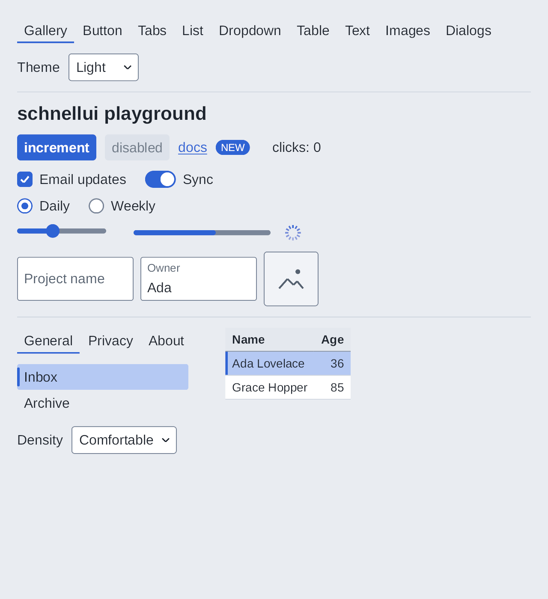

# schnellui

**schnellui** *(schnell = "fast")* is a macro-first, signal-first, GPU-accelerated Rust UI framework with a retained scene, first-class AccessKit accessibility, and multi-target rendering.

Instead of rebuilding a virtual tree or re-encoding the entire window every frame, `schnellui` builds a retained scene once and wires signals directly to the nodes they affect. Steady-state re-renders allocate **zero bytes on the heap** — enforced as a hard CI gate.



*The playground gallery in the Light theme. Regenerate it with `cargo run -p playground -- --scenario gallery --scale 2 --out docs/images/playground.png`.*

## Highlights

- **Macro-first + typed builders** — Write declarative trees with `view! { ... }` or compose the equivalent typed builder chain directly. Static subtrees are hoisted at compile time; only dynamic slots and reactive attributes get reactive wiring.
- **Signal-first reactivity & stores** — Fine-grained push-then-pull signals, memos, effects (`schnellui::signal`), and selector-pruned shared stores (`schnellui::store`) backed by a `Send + Sync` generational arena.
- **Zero-allocation steady-state re-render** — Signal updates patch retained nodes in place with zero heap allocations on the steady-state hot path, verified by `alloc_budget` and `schnellui-bench` in CI.
- **Multi-target rendering**:
  - **Native GPU (`render_wgpu`)** — Vulkan, Metal, and DX12 via `wgpu`, with per-node incremental instance slot patching, sub-rect glyph/image atlas uploads, and a 128 px tile picture cache.
  - **SIMD CPU renderer (`render_soft`)** — 8-lane SIMD (AVX / portable) rasterizer over the same instance buffers and tile damage. Used automatically when no GPU is available, while the GPU initializes in the background on window startup, or explicitly via `Backend::Cpu` / `SCHNELLUI_BACKEND=cpu`.
  - **Semantic HTML, CSS, WASM & SSR (`render_html`, feature `render-html` / `ssr`)** — Renders `Template` trees directly to semantic DOM and CSS (not `<canvas>`), with keyed reconciliation, responsive `@media`/`@container` rules, typed SSR-to-CSR hydration, and an authorization-enforced router.
  - **Native Android views (`render_android`, feature `render-android`)** — Renders `Template` trees into real `android.widget` views via a diffed binary op buffer and a zero-dependency Java host library.
- **First-class accessibility (`a11y`)** — Every widget declares an AccessKit role, name, value, state, and actions. Accessibility updates ride the same dirty channels as paint, and inbound assistive `ActionRequest`s route to the exact same handlers as mouse and keyboard input.
- **Built for automated testing & AI agents** — Every example can render deterministic one-shot PNGs, dump its AccessKit semantic tree (`--dump-a11y`), assert semantic invariants (`--assert`), or run live offscreen (`--headless-windowed`) driven via `schnellui-debug` without opening a desktop window.

## Quick Example

A component function runs **once** to construct the retained tree. Reactivity lives only in the dynamic `(expr)` slots, reactive closure attributes, and event handlers:

```rust
use schnellui::a11y::Role;
use schnellui::signal::create_signal;
use schnellui::widgets::View;
use schnellui::{view, App};

fn counter_view() -> impl View {
    let count = create_signal(0_i64);

    view! {
        pad(all = 20.0) {
            column(gap = 8.0) {
                text(size = 24.0) { "Counter" }
                text(role = Role::Status) { (count.get()) }
                button(on:click = move || count.set(count.get() + 1)) { "Increment" }
            }
        }
    }
}

fn main() -> Result<(), Box<dyn std::error::Error>> {
    let mut app = App::mount_with_size(counter_view(), 400, 200);

    // Open a native desktop window (uses winit + wgpu, with SIMD CPU fallback):
    app.run_windowed("Counter")?;

    // Or render a single deterministic frame headlessly to a PNG:
    // app.frame();
    // app.render_to_png("counter.png")?;
    Ok(())
}
```

## Trying the Examples

Run any example in a live desktop window with `--windowed`, or capture a deterministic headless PNG (the default):

```sh
# Interactive widget gallery in a desktop window (includes live theme switcher)
cargo run -p playground -- --scenario gallery --windowed

# One-shot headless screenshot + semantic tree dump + assertions
cargo run -p counter -- --scenario counter_five --out counter.png --dump-a11y tree.json --assert

# Force the SIMD CPU renderer
SCHNELLUI_BACKEND=cpu cargo run -p playground -- --scenario gallery --windowed
```

See [examples/README.md](examples/README.md) for the full progression of 23 examples (counter, calculator, todo, responsive flexbox, dialogs, dockable workspace, charts, rich text, HTML/SSR router, Servo browser embedding, Android native views, and more).

## Workspace Crates

| Crate | Purpose |
| --- | --- |
| [`crates/schnellui`](crates/schnellui) | Umbrella framework crate: `App`, `view!`, signals, stores, scene, Taffy layout, Parley text, widgets, themes, charts, icons, localization, motion, AccessKit a11y, platform integration, `render_wgpu`, `render_soft`, `render_html`, `render_android`, and `testing`. |
| [`crates/schnellui-view-parser`](crates/schnellui-view-parser) | Compiler-independent `view!` parser, AST, static/dynamic classifier, and hot-reload template tooling. |
| [`crates/schnellui-macro`](crates/schnellui-macro) | Procedural macro crate implementing `view!`. |
| [`crates/schnellui-debug`](crates/schnellui-debug) | CLI client for inspecting and driving live native or `--headless-windowed` apps over local debug sockets. |
| [`crates/schnellui-icons-md`](crates/schnellui-icons-md) | Material Design icon adapter implementing `schnellui::icons::IconSource`. |
| [`crates/schnellui-servo`](crates/schnellui-servo) | Servo browser engine embedding and session persistence. |
| [`crates/schnellui-fuzz`](crates/schnellui-fuzz) | Property-based interaction, resize, and layout fuzzing suite. |
| [`bench`](bench) | `schnellui-bench`: deterministic allocation budgets and document-size scaling benchmarks. |

> **Tip:** Exclude `servo_demo` when running workspace-wide cargo commands (`--exclude servo_demo`) unless you are working on Servo integration, as building Servo compiles the full browser engine.

## Documentation

Start with the [documentation index](docs/README.md) or jump directly to a guide:

### User Guides
- **[Getting Started](docs/getting-started.md)** — Setup, Cargo features, lifecycle (`mount` → `frame` → `render`), running modes, and environment variables.
- **[Reactivity & State](docs/reactivity.md)** — Signals, memos, effects, scopes, `Store`/`Selector`, reactive attributes, subtree replacement, remounts, and zero-allocation discipline.
- **[Widgets, Layout & Theming](docs/widgets-and-layout.md)** — Layout vs widget separation, `view!` syntax reference, full widget catalog, `Theme`/`Shape` tokens, localization, motion, and platform integration.
- **[Renderers & Targets](docs/renderers.md)** — Native `wgpu`, SIMD CPU (`render_soft`), semantic HTML/CSS/SSR/WASM (`render_html`), native Android views (`render_android`), and Servo embedding.
- **[Accessibility, Testing & Agents](docs/accessibility-and-testing.md)** — First-class AccessKit, semantic assertions, perceptual golden diffs, simulation/fuzzing, and AI-agent workflows.

### Reference & Deep Dives
- **[Architecture](docs/architecture.md)** — Exact code-level walkthrough of the runtime, frame pass, incremental GPU/CPU rendering, text shaping, terminal grids, HTML reconciler, and current gaps against `SOUL.md`.
- **[SOUL.md](SOUL.md)** — Design philosophy, prime directives, and architectural north star.
- **[Android Renderer Spec](docs/android-renderer.md)** & **[Android Host Setup](android/README.md)** — Binary op buffer format, JNI contract, and Gradle build instructions.
- **[Live Debug Instrumentation](docs/debugging/DEBUG_INSTRUMENTATION.md)** — Local debug server, `schnellui-debug` CLI, jq selectors, waits, captures, and command scripts.
- **[Interaction & Remount Tracing](docs/debugging/INTERACTION_DEBUGGING.md)** — Structured JSONL event tracing for pointer routing, focus, drags, and remounts.
- **[Binary Size](docs/binary-size.md)** — Recommended Cargo profiles for shrinking debug and release builds.
- **[Examples Catalog](examples/README.md)** — All 23 examples, CLI flags, and `--headless-windowed` workflows.

## Testing, Benchmarks & CI

The full local CI gate is [`scripts/ci.sh`](scripts/ci.sh). Because the signal graph is process-global, run Rust tests with `--test-threads=1`:

```sh
# Full CI gate (formatting, core/HTML/Android tests, headless-windowed integration, allocation gates)
./scripts/ci.sh

# Allocation-budget tests (hard zero-alloc gate on steady-state re-render)
cargo test -p schnellui --features count-allocations --test alloc_budget -- --test-threads=1

# Allocation and scaling benchmark suite
cargo run --release -p schnellui-bench

# Allocation-only benchmark gate (deterministic on busy/shared machines)
cargo run --release -p schnellui-bench -- --allocations-only --iters 100
```

## AI Disclosure

This project is being developed with AI assistance.

## License

Licensed under either of

- Apache License, Version 2.0 ([LICENSE-APACHE](LICENSE-APACHE))
- MIT License ([LICENSE-MIT](LICENSE-MIT))

at your option.

Unless you explicitly state otherwise, any contribution intentionally submitted
for inclusion in schnellui by you, as defined in the Apache-2.0 license, shall
be dual licensed as above, without any additional terms or conditions.
