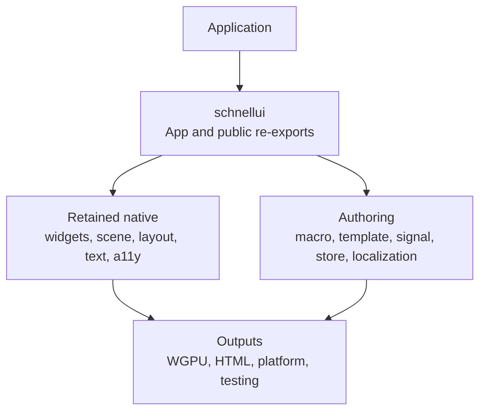
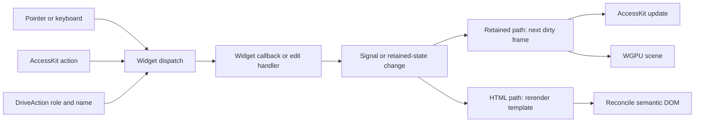
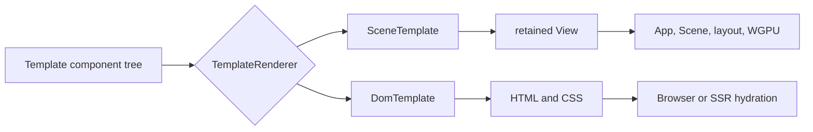

# SchnellUI architecture

This document describes the code as it is today. Each mechanism names the file and
function that implements it, so you can check a claim against the source. Where
[SOUL.md](../SOUL.md) promises something the code does not do yet, the gap is listed
in [Known gaps against SOUL.md](#known-gaps-against-soulmd).

SchnellUI has two complementary UI paths:

- A retained native path: build a `View` tree once, then update the retained scene
  incrementally and render it with WGPU.
- A renderer-generic path: express components as `Template` values and render the
  same value either into the retained tree or into semantic HTML.

The umbrella [`schnellui`](../crates/schnellui/src/lib.rs) crate is the application
boundary. It re-exports the public building blocks and owns the native runtime.



## Workspace layers

The pillars are separated by responsibility rather than by widget:

| Layer | Modules of `schnellui` | Responsibility |
| --- | --- | --- |
| Authoring | [`schnellui-macro`](../crates/schnellui-macro), [`schnellui-view-parser`](../crates/schnellui-view-parser), [`schnellui::template`](../crates/schnellui/src/template), [`schnellui::signal`](../crates/schnellui/src/signal), [`schnellui::store`](../crates/schnellui/src/store), [`schnellui::localization`](../crates/schnellui/src/localization) | `view!` parsing and code generation, renderer-neutral component values, local signals, selector-backed shared state, messages. |
| Retained model | [`schnellui::widgets`](../crates/schnellui/src/widgets), [`schnellui::scene`](../crates/schnellui/src/scene), [`schnellui::layout`](../crates/schnellui/src/layout), [`schnellui::text`](../crates/schnellui/src/text) | Builds widgets into a retained scene, computes geometry, shapes text, keeps interaction callbacks. |
| Native integration | [`schnellui`](../crates/schnellui), [`schnellui::render_wgpu`](../crates/schnellui/src/render_wgpu), [`schnellui::platform`](../crates/schnellui/src/platform), [`schnellui::a11y`](../crates/schnellui/src/a11y) | App lifecycle, GPU presentation, window events, AccessKit trees. |
| Alternative output and support | [`schnellui::render_html`](../crates/schnellui/src/render_html), [`schnellui::testing`](../crates/schnellui/src/testing), themes, icons, charts, Servo | DOM and CSS rendering, scenario testing, optional domain integrations. |

`schnellui::store` is a signal-backed facade for shared application models. A
`Store<T>` owns the state, and `Selector` values expose equality-gated derived
projections to the reactive graph. Retained dynamic widgets attach callback-free
subscriptions to that graph, so a frame evaluates only producers whose tracked
projection may have changed. The `!Send` producer and all scene mutation stay with
the app-local widget runtime.

Examples are workspace members too. Start with [`hello`](../examples/hello/src/main.rs),
[`counter`](../examples/counter/src/main.rs) and
[`html_native`](../examples/html_native/src/main.rs). The full list is in
[examples/README.md](../examples/README.md).

## Retained native runtime

`App::mount*` calls `View::build` once ([`App::mount_boxed`](../crates/schnellui/src/app_new.rs)).
The resulting widgets populate an app-owned runtime (callbacks and dynamic slots) and
a retained [`Scene`](../crates/schnellui/src/scene/scene.rs). Later frames do not
rebuild the view. Signal subscriptions and dynamic slots mutate the affected scene
data, and the dirty channels (below) name the work left to do.

Normal reactivity updates existing nodes. There is no virtual DOM. A tree-shape change
is explicit: replace a referenced subtree with
[`App::replace_subtree`](../crates/schnellui/src/app_lifecycle.rs), or use one of the
windowed remount and update hooks in
[`structural_update`](../crates/schnellui/src/structural_update.rs).

`view!` emits a typed builder chain and a hoisted `Template` constant. The parser
classifies inert subtrees and dynamic sites at compile time. Static text constructors
read their literal from this shared skeleton. `TemplateNodeView` records the retained
node at each source path during mount; `TemplateView` registers the macro site by its
compiled `file:line:column`. Later signal updates drain subscriptions without walking
the skeleton. A `(expr)` child becomes `Text::dynamic_into`.

Closure-valued attributes use `View::reactive_attr`. The producer runs under tracking
at mount and after its dependencies change. It updates the same retained node and
keeps its previous value, so an unchanged result produces no dirty work. Supported
properties include color, font size, width and height, min/max bounds, flex factors,
gap, padding, disabled, and checked. Plain Rust configuration expressions and event
handlers keep their builder semantics. For example:

```rust,ignore
use schnellui::{scene::Color, signal::create_signal, view};
let color = create_signal(Color::BLACK);
let size = create_signal(16.0_f32);
let view = view! {
    text(color = move || color.get(), size = move || size.get()) { "Reactive style" }
};
```

Hot reload is opt-in through `App::enable_hot_reload("127.0.0.1:0")`. It accepts
newline-delimited JSON `TemplateBlueprint` data and validates every mounted instance
before applying an edit. Static text, supported literal attributes, and static
text/container child insertions and removals can change without rebuilding Rust.
Dynamic nodes and their subscriptions keep their identities even when static siblings
shift. Rust expression or handler changes, unsupported widget edits, and attribute
removals return `ReloadError::RebuildRequired`. `take_hot_reload_results` exposes
successes and failures. The native host polls the endpoint every 50 ms while enabled.

The parser example sends replacements or watches a file containing one `view!` body:

```sh
cargo run -p schnellui-view-parser --example hot_reload -- \
  --watch view.body 'src/main.rs:20:16' 127.0.0.1:7777
```

Use the compiled macro site's ID from `view.template().id`; source positions are the
identity, so moving the Rust macro itself requires rebuilding.

```rust,ignore
use schnellui::{view, App};
use schnellui::widgets::View;

fn ui() -> impl View {
    view! { column { text { "Hello, schnellui" } } }
}

let mut app = App::mount_with_size(ui(), 400, 160);
app.frame();
app.render_to_png("hello.png")?;
```

### The signal runtime

[`schnellui::signal`](../crates/schnellui/src/signal/mod.rs) keeps its graph in one
arena behind a process-wide lock ([`arena.rs`](../crates/schnellui/src/signal/arena.rs),
`RUNTIME`). `Runtime::flush` returns early when both queues are empty. Otherwise it
drains pending effects and subscriptions until the queues are empty, and gives up after
`MAX_FLUSH_ROUNDS` (1000) rounds, which means a reactive cycle. Ready-queue removal is
O(1) ([`subscription.rs`](../crates/schnellui/src/signal/subscription.rs)).

A `Subscription` is a callback-free dependency tracker. `Subscription::track(f)` runs
`f` with the subscription as the observer, replaces its old edges and consumes its
ready state. A nested `track` on a running subscription joins the outer run. A
`SubscriptionGroup` owns many subscriptions and one ready-key queue. UI code drains
the queue with `drain_ready_into`, so the arena stores integer keys and never the
closures themselves.

## The frame pass

[`App::frame`](../crates/schnellui/src/app_lifecycle.rs) runs `settle_frame`, then
`Scene::clear_dirty`. The native host calls `settle_frame` directly so it can publish
accessibility changes and present pixels before it clears the channels
([`WindowedApp::redraw`](../crates/schnellui/src/windowed/host.rs)). One-shot headless
rendering has no event loop. The persistent headless windowed host uses a channel
loop instead of winit, with the same frame, remount, timer, and controller-wake
handling. It creates no native window, accessibility adapter, or system clipboard
connection. Debug screenshots use the offscreen renderer; viewport dimensions
stay at the mounted size. `SCHNELLUI_HEADLESS_WINDOWED=1` selects it for every
`App::run_windowed*` method, or callers can use `App::run_headless_windowed`.
`settle_frame` does this, in order:

1. `Runtime::flush`, then `poll_theme_binding`
   ([`app_theme.rs`](../crates/schnellui/src/app_theme.rs)). A reactive theme binding
   re-runs only when a signal it read changed. A changed theme rebuilds the whole tree
   first, so the rest of the frame works on the replacement. The opt-in template
   reload endpoint applies validated data edits before the remaining passes.
2. A second `Runtime::flush` to deliver subscription readiness.
3. `PaintBindings::run` ([`bindings.rs`](../crates/schnellui/src/bindings.rs)). Each
   `bind_paint` closure owns a `Subscription` and runs on the first frame and then only
   after a signal it read changed. The result goes through `Scene::set_color`, which
   compares before writing, so an unchanged colour stays clean. No relayout, no
   allocation.
4. `run_reactive_attributes` applies ready style/state producers, then
   `run_dynamic_slots` ([`frame.rs`](../crates/schnellui/src/widgets/lib/frame.rs)).
   Dynamic text, rich text and terminal grids are tracked the same way
   ([`reactivity.rs`](../crates/schnellui/src/widgets/lib/reactivity.rs)).
   Externally clocked terminals (`dynamic_versioned` and `patched`) are polled at
   the end of `run_dynamic_slots` by `poll_dynamic_sources` on every settled frame,
   with or without a signal change (see [Terminal grids](#terminal-grids)). Only ready
   producers run, and each writes into a reused buffer. The slot compares the new text
   with the last value by borrow, so an unchanged value allocates nothing. A changed
   value updates the a11y name or value, re-emits the glyphs, and flags paint and
   a11y. It flags layout as well only when the measured width changed, or always for
   wrapped text.
5. Other pulls: dynamic images, edge auto-scroll, spinners and floating labels (the
   last two only when animations are enabled), and finished async SVG rasters.
6. Layout, in a loop of at most three passes (a virtual list may need follow-up
   passes). A pass runs when the tree was never laid out, a virtual list changed, or
   `Scene::layout_dirty` is not empty and `Scene::layout_epoch` moved past
   `layout_consumed_epoch` (the list outlives a settle, the epoch does not). The first pass calls
   `LayoutEngine::sync_tree`. Later passes call `sync_dirty_nodes` for the nodes on
   `Scene::layout_dirty` only. Then `compute_with` runs Taffy (see below), followed by
   `clamp_scroll_offsets`, `emit_wrapped_paint` and `reposition_paint`.
7. Per-frame paint emitters that do not depend on layout: `emit_terminal_grid_paint`
   and `emit_scrolled_text_areas`. Scrolling never relayouts, so a text area in a
   scroll view re-emits its visible row band here.
8. `PaintBindings::reapply` puts bound colours back on nodes that widget code
   repainted in step 4 to 7, without calling the closures.

### Layout, change tracking and repositioning

[`LayoutEngine`](../crates/schnellui/src/layout/engine.rs) keeps a resident Taffy
tree. `compute_with` takes a width-aware `DynMeasure` hook
([`types.rs`](../crates/schnellui/src/layout/types.rs)). Only leaves flagged with
`set_width_aware` (wrapped text, rich text, wrapping text areas) are offered to the
hook. Every other leaf uses its fixed `MeasureFn`. The hook the app passes is
[`measure_text`](../crates/schnellui/src/widgets/lib/frame.rs), which caches sizes per
width in a small ring on the text layout. Wrapped text is shaped once per width, and
`emit_wrapped_paint` reuses that shape.

After Taffy runs, `write_boxes` compares each node with the `Placed` geometry last
written for it. A node whose placement did not change is skipped, and the walk
descends past it only when it lies on the ancestor chain of a node the engine
invalidated (`touched`). A changed box goes through `Scene::set_layout`, which
marks the node paint-dirty and a11y-dirty, appends it to `Scene::geometry_changed`,
and advances the geometry epoch. An identical box is a no-op.

`reposition_paint` walks `Scene::geometry_changed` and slides each node's primitives
so their origin matches the laid-out origin (`reposition_node`). Widgets paint at a
provisional origin during build and when text changes. Nodes that already sit at their
origin are not written. Wrapped text, rich text and terminal grids emit absolute
positions themselves and are skipped. The pass then calls `Scene::clear_geometry_changed`.

## Dirty channels and their consumers

The [`Scene`](../crates/schnellui/src/scene/scene.rs) tracks changes as sparse lists
and counters, not as a damage rectangle. `Scene::mark_dirty` is the only writer.

| Channel | Where it lives | Who reads it |
| --- | --- | --- |
| Paint | `paint_dirty()` list, monotonic `paint_epoch()`, `paint_dirty_base_epoch()` | The GPU renderer patches instance slots for the listed nodes. Hit-test caching compares the epoch. |
| Geometry | `geometry_changed()` list, geometry epoch inside `render_key()` | `reposition_paint`. A renderer that caches absolute geometry compares the whole `SceneRenderKey`. |
| A11y | `a11y_dirty()` list | `build_incremental_tree_update` and `plan_accessibility_update`. |
| Layout | `layout_dirty()` list, `layout_epoch()` | `settle_frame` and `sync_dirty_nodes`. |
| Structure | `render_revision()` | Only structural changes bump it: insert, remove, reorder, root, visibility, overlay stacking. The renderer and the a11y planner treat a change as "rebuild". |

Details worth knowing:

- `clear_dirty` drains only nodes that were dirtied (it keeps a `dirtied` list) and
  sets `dirty_base_epoch` to the current paint epoch. It does not reset
  `paint_epoch`, so a renderer that remembers the epoch it last drew can tell whether
  anything was painted since, even after the lists were cleared.
- `paint_mut` and `a11y_mut` mark the node dirty before returning the reference, so
  an edit cannot be missed. `a11y_text_mut` is for name and value writes only. It
  keeps the modal, focus and tab-order caches.
- The scene stores no union damage rectangle. Renderer tile fingerprints identify
  raster damage, including the vacated area of moved or removed primitives.

## The GPU path

[`schnellui::render_wgpu`](../crates/schnellui/src/render_wgpu/mod.rs) has two entry
points in [`renderer.rs`](../crates/schnellui/src/render_wgpu/renderer.rs): the
offscreen `Renderer` (PNG and RGBA readback) and the windowed `SurfaceRenderer`. Both
wrap one `GpuCore` ([`gpu_core.rs`](../crates/schnellui/src/render_wgpu/gpu_core.rs)).
`App::render_to_png`, `render_rgba8` and `render_to_surface`
([`app_render.rs`](../crates/schnellui/src/app_render.rs)) hand it the scene and the
glyph atlas.

Each renderer keeps its own view of the scene. `GpuCore` stores
`retained_scene_key` (a `SceneRenderKey`) and `retained_paint_epoch`, so the headless
renderer and a windowed one can share one scene and each stay current.

`GpuCore::upload_scene` calls `try_incremental` first:

- Per-node retained instance slots. The last full `gather` records, for each node, the
  range it occupies in the quad, glyph and image instance buffers (`FragmentTable`). A
  paint-dirty node re-encodes only its own primitives (`update_node`) and rewrites its
  slot. If the node outgrew its slot, `grow_slot` splices the CPU mirror, shifts every
  slot drawn after it and moves the layer boundaries, so draw order stays the same.
  Only the changed bytes are uploaded (`upload_range`).
- Ranged node patches. A node written through `Scene::paint_range_mut`
  ([`scene.rs`](../crates/schnellui/src/scene/scene.rs)) records the changed
  primitive ranges, and `Scene::paint_dirty_ranges` returns them until the next
  `clear_dirty`. Any other paint write this frame (`paint_mut`, `mark_dirty`,
  `set_color`) makes the node whole-node dirty again. `GpuCore::update_node_ranges`
  re-encodes only the primitives in those ranges and writes them over the instances
  they produced last time, found through a per-node `PrimPrefix` (instance offsets per
  primitive, built by `rebuild_prefix` the first time a node reports ranges and after
  each whole-node re-encode of it). If a range now produces a different number of
  quad, glyph or image instances, or the prefix no longer matches the fragment's
  offset, clip, primitive count or live counts, the node falls back to `update_node`.
  A full gather drops every prefix; a scroll re-walk drops those of the fragments it
  stamped. `GpuUploadWork::ranges_patched` and `primitives_encoded` count the work.
- Scroll re-gather. A dirty `Scroll` node re-walks its whole content run
  (`regather_scroll`) because its offset moved every descendant. The CPU cost is the
  number of nodes under the scroll node, and the upload is the visible instances.
  Scroll translation participates in the inherited property tree, but updating
  instance coordinates still costs the number of nodes under that viewport.
- Epoch check. If `retained_paint_epoch == scene.paint_epoch()`, nothing was painted
  and no work is needed, even when the frame pass already cleared the lists.

`upload_scene` still does a full `gather` and uploads every buffer when
`try_incremental` returns `false`. That happens when:

- the scene identity or `render_revision` differs from the retained key (a remount,
  or any structural change);
- `layout_dirty` is not empty;
- the renderer last drew before the most recent `clear_dirty`
  (`retained_paint_epoch < paint_dirty_base_epoch()`), so the dirty list no longer
  names everything it missed;
- the dirty list is empty but the epoch differs;
- a dirty node is missing from the scene, or is visible but was never reached by the
  last gather;
- a dirty overlay root changed its level or order (`overlay_unchanged`);
- a scroll region cannot be rebuilt in place.

Atlases are shared with other renderers. `sync_atlas` reads the glyph atlas write log
through `GlyphAtlas::delta_since(generation)` and uploads nothing, one sub-rect or the
whole texture. A different atlas id forces a full upload. `ensure_image_atlas` does the
same for the image atlas. `SurfaceRenderer::invalidate_atlases` and
`reconcile_remount_atlases` handle remounts.

Uploads are counted. `Renderer::last_upload_bytes` and `SurfaceRenderer::last_upload_bytes`
return `UploadBytes` (`instance_bytes` and `other_bytes`, which holds uniforms and
atlas texels). The counter is always on, and a frame with nothing painted reports
zero. The crate's tests also read `GpuUploadWork` (full gathers, nodes patched, scroll
regions, grown slots) to prove a paint change did not fall back to a full gather
([`retained_tests.rs`](../crates/schnellui/src/render_wgpu/retained_tests.rs)).

Overlays (dropdown lists, dialogs, context menus) are deferred out of the base walk
and drawn after it, in `(level, order)` order, as separate layers.

`Scene::set_composite_properties` records translation and clip properties separately
from layout and paint. Parent links resolve inherited properties for rendering,
pointer and wheel targeting, and accessibility bounds. Changes invalidate geometry
indexes and dirty affected accessibility nodes without requesting a layout pass.

Both renderers have a persistent GPU picture cache split into 128-pixel tiles
([`tile_cache.rs`](../crates/schnellui/src/render_wgpu/tile_cache.rs)). Each tile hashes
its intersecting instances, compositing order, and relevant atlas identities and
revisions. An unchanged frame bypasses hashing and raster work. A changed tile is
scissored into a scratch texture and copied into the resident picture. Removed or
moved content changes the old tile's dependencies, clearing its vacated pixels.
`last_tile_cache_stats` reports hits and rasterized tiles. Native surfaces receive a
copy of the cached picture; surfaces without `COPY_DST` support use full raster.

This cache still scans all instances for each tile on changed frames. It has one
picture rather than separate slices by update frequency. Dirty frames clear the
scratch attachment as a whole, and property edits still gather instance coordinates.
These costs remain candidates for further performance work.

## Text

[`schnellui::text`](../crates/schnellui/src/text/mod.rs) has two pieces.

- `TextShaper` ([`shaper.rs`](../crates/schnellui/src/text/shaper.rs)) wraps Parley.
  The font collection is built once per process (`BaseFonts::get`, a `OnceLock`) and
  each shaper clones it, so creating an app does not reload fonts. `shape_into` shapes
  into a caller-owned `ShapedText` that keeps its capacity, so a call site shapes
  without allocating once it has grown. `shape` and `shape_with` return a fresh value
  and are for cold paths. `TextShaper::detached` is a font-less stand-in used for a
  shaper that will be dropped.
- `GlyphAtlas` ([`types.rs`](../crates/schnellui/src/text/types.rs)) is a shelf-packed R8
  texture. Every written rect bumps `generation` and goes into a bounded write log.
  When a glyph does not fit, the rasterizer calls `grow` (doubling the height up to a
  cap) only if `can_ever_fit` says growth can help. Growth bumps the generation and
  drops the log, so renderers re-upload fully. `has_headroom` tells callers whether an
  atlas is too full to carry over.

The text engine (shaper and atlas) outlives the tree it was built for:

- Theme rebuilds. `rebuild_with_theme` ([`app_theme.rs`](../crates/schnellui/src/app_theme.rs))
  moves the shaper and atlas into the replacement app and leaves the old app a
  detached shaper and a 1x1 atlas. Glyphs already rasterized stay cache hits and the
  renderer keeps its texture. If the atlas has no headroom, the replacement starts
  fresh.
- Remount hooks. `App::with_remount_engine`
  ([`app_new.rs`](../crates/schnellui/src/app_new.rs)) lets a hook build its
  replacement on the running engine. The first `App::new` inside the hook claims a
  fork: `TextShaper::fork` copies the glyph cache and font ids, and `GlyphAtlas::fork`
  keeps the atlas id and write log. The host calls `GlyphAtlas::resolve_fork` when it
  installs the replacement ([`host.rs`](../crates/schnellui/src/windowed/host.rs),
  `poll_remount`). The fork keeps the id only if the running atlas wrote nothing since
  the fork. Otherwise it gets a new id and the renderer treats it as a new atlas.
  `App::adopt_text_engine` does the same by swap for a freshly constructed app.

## Terminal grids

[`TerminalGrid`](../crates/schnellui/src/widgets/terminal_grid.rs) paints a fixed-cell
terminal viewport. Its model is `TerminalGridModel`, a row-major `Vec<TerminalCell>`.

Cells own no heap memory in the common case. `TerminalCell::grapheme` is a
`CompactString` (the `compact_str` crate, re-exported from the module), which keeps
up to 24 bytes inline, and `TerminalCell::hyperlink` is an `Option<Arc<str>>`, so a
run of linked cells shares one allocation. Cloning a cell or `clone_from` never
allocates (`terminal_cell_clone_allocates_nothing` in
[`alloc_budget.rs`](../crates/schnellui/tests/alloc_budget.rs)). The per-face glyph
shape cache, `TerminalGridState::glyph_shape_cache`, is keyed by `CompactString` and
looked up by `&str`, so a cache hit allocates nothing.

There are four sources:

| Constructor | How updates arrive | Per-update work |
| --- | --- | --- |
| `TerminalGrid::new` | none | none |
| `TerminalGrid::dynamic` | a tracked signal subscription | the closure builds a full model, `plan_incremental_paint` diffs every cell |
| `TerminalGrid::dynamic_versioned` | a polled `u64` revision | same as `dynamic`, only when the revision moves |
| `TerminalGrid::patched` | a polled `u64` revision | the host writes changed rows in place; no clone, no diff |

`TerminalGrid::patched(revision, patch)` hands the closure a `TerminalGridPatch`
([`patch.rs`](../crates/schnellui/src/widgets/terminal_grid/patch.rs)) that borrows
the retained state. `row_mut` returns one row's cells and marks that row's paint and
accessible text dirty. `set_cursor` and `set_selection` compare first and dirty only
the old and new rows. `resize` keeps the overlapping cells, requests layout and marks
everything dirty. `set_colors`, `set_images` and `images_mut` cover the rest. The
patch also runs once during `View::build`, against an empty 0x0 model, so the host
fills the grid before the first frame.

`apply_patch` ([`interaction.rs`](../crates/schnellui/src/widgets/terminal_grid/interaction.rs))
removes the `TerminalGridState` from the registry while the closure runs, so no
registry borrow is held across user code, then puts it back and publishes the
channels it touched. The host wakes the window with `App::redraw_signal()`.
`WindowedApp::redraw` runs `settle_frame`, which reaches `poll_dynamic_sources`
through `run_dynamic_slots`.

Dirty rows live in a `RowSet` (a flag per row plus a list of the set rows). Paint
work is proportional to the dirty rows:

- `emit_one` returns at once when nothing is dirty. Otherwise
  `rebuild_dirty_rows` walks the list and re-emits each row's background runs and
  glyphs into its cached `TerminalRowPaint`.
- `pad_row_fragment` pads each row's background and glyph fragments with
  invisible 1x1 primitives (zero alpha, inside the row) up to a grow-only capacity,
  1.5x the largest count seen plus 4. Typing at a prompt therefore fills a spare slot
  instead of growing the row. Rows that never held content stay empty, so a blank
  grid is still one backdrop primitive.
- `patch_dirty_rows` sorts the list in place. If no row changed its primitive
  count, each row's background and glyph fragments are copied over their ranges with
  `Scene::paint_range_mut`, so the renderer re-encodes only those rows (see
  [The GPU path](#the-gpu-path)), and `TerminalPaintCache::reindex` (O(rows)) is
  skipped. Otherwise the rows are spliced through `paint_mut` and the node is
  re-encoded whole. A cursor change of unchanged length rewrites only the cursor
  range, the last section, the same way.
- `emit_one` is the only place a terminal marks itself paint-dirty.
  `apply_patch` and `apply_dynamic_model` leave paint to it, because a blanket
  `mark_dirty(PAINT)` would turn the recorded ranges back into a whole-node update.

The accessible value is the grid's plain text, rows joined by `\n`.
`sync_a11y_value` keeps it in the node's existing `A11yData::value` string. After
mount or a resize it rebuilds the value in place. Otherwise it re-renders only the
rows on `a11y_rows` into a scratch buffer, compares each with its byte range
(`a11y_row_ends`) and splices a changed row with `String::replace_range`, shifting the
later offsets when the length moved. An identical rewrite leaves the node a11y-clean.
The full-model sources use the same function, fed by the rows
`plan_incremental_paint` found with changed text, so they no longer allocate a fresh
`plain_text` string per update.

Measured on an 80-column grid, one row rewritten with glyphs already cached:

| Path | 24 rows | 240 rows |
| --- | --- | --- |
| `dynamic_versioned`, before this change | 48 allocations, 127,006 bytes | 52 allocations, 1,294,366 bytes |
| `dynamic_versioned`, now | 1 allocation, 107,520 bytes | 1 allocation, 1,075,200 bytes |
| `patched` | 0 | 0 |

The counts cover one `App::frame` after the revision moved. The remaining
`dynamic_versioned` allocation is the host closure's full model clone.

`patched_terminal_row_rewrite_allocates_nothing` gates the last row. Building the
AccessKit `TreeUpdate` for the changed terminal node copies the whole value into
AccessKit's `Node`, so it is budgeted separately
(`patched_terminal_a11y_update_stays_within_budget`, `TERMINAL_A11Y_UPDATE_BUDGET`).
Its allocation count is the same at 24 and 240 rows; its bytes follow the text length.

On the renderer side, `terminal_row_echo_reencodes_and_uploads_one_row`
([`retained_tests.rs`](../crates/schnellui/src/render_wgpu/retained_tests.rs)) echoes
one 200-glyph row in a 200x60 grid (12,061 primitives). Through `paint_mut` the
renderer re-encodes all 12,061 primitives and `patch_slot` then finds the 12,800
changed bytes. Through `paint_range_mut` it re-encodes the row's 200 primitives and
uploads the same 12,800 bytes (200 glyph instances). Typing one character into a
padded row re-encodes 1 primitive and uploads 64 bytes. The same character inserted
into an unpadded row re-encodes 12,062 primitives and uploads 371,264 bytes, because
every later glyph instance shifts. `ranged_edits_match_a_full_gather` checks ranged
patches against a full gather after every step. The bench measures only the CPU frame
pass, so this GPU-side number has no bench row.

## Streamed images

`Image::dynamic_rgba_versioned(revision, frame)`
([`media.rs`](../crates/schnellui/src/widgets/lib/media.rs)) shows a stream of RGBA
frames, such as a browser panel, without remounting. `poll_dynamic_images`
([`frame.rs`](../crates/schnellui/src/widgets/lib/frame.rs)) calls `revision` every
frame and `frame` only when it moved:

- A frame no larger than the image's allocation is copied over its existing texels
  with `ImageAtlas::write_rect_strided`
  ([`types.rs`](../crates/schnellui/src/scene/types.rs)). The write is logged, so
  `GpuCore::ensure_image_atlas` uploads that sub-rect only. The quad samples just the
  current frame, so shrinking keeps the larger allocation as capacity.
- A larger frame needs a new region. The old one goes back with `ImageAtlas::free`
  once the new one is in place. The new allocation is at least 1.25x the old one in
  each direction, so a panel dragged wider re-allocates a few times rather than once
  per pixel.
- When the atlas cannot fit the frame (it is capped at `ImageAtlas::MAX_DIM`, 4096,
  per side) the image keeps the largest region it can get and shows the frame's
  top-left crop rather than freezing.

A 1920x1080 frame fits. The first one grows the shared atlas to 2048x2048, a one-time
full upload. `ImageAtlas::log_write` reserves its bounded write log on first use, so a
same-size frame update allocates nothing (`streamed_image_frame_allocates_nothing`,
bench row `browser_frame_stream`). The [`servo`](../examples/servo/src/main.rs)
example publishes each new Servo frame into a `FrameFeed` behind this constructor and
remounts only when navigation state, the viewport or the address bar changes.

Image regions follow their widgets. When a subtree is replaced, `purge_nodes` hands
the regions of its pixel images, streamed images and terminal grid images back with
`ImageAtlas::free`, which clears them and keeps them on a free list. Allocation takes
the smallest free region that fits before it opens new shelf space, and freed
neighbours merge, so a panel that remounts with the same image reuses its old region
instead of growing the atlas toward `MAX_DIM`.

## Accessibility

Widgets record roles, names, values, states, actions and bounds in the scene's a11y
column. [`schnellui::a11y`](../crates/schnellui/src/a11y/mod.rs) turns that data into
AccessKit `TreeUpdate`s. The retained widget id is the AccessKit node id
(`to_access_id`).

The native host chooses one of three updates per frame
([`plan_accessibility_update`](../crates/schnellui/src/windowed/host.rs)):

- `Skip`: nothing is a11y-dirty and the focus target did not change
  (`incremental_update_needed`).
- `Incremental`: send only the nodes on `a11y_dirty()` (`build_incremental_tree_update`).
  A node whose box moved is on that list because `set_layout` marks it, so a reflow
  does not need a full tree.
- `Full`: first publish, remount, resize, a title change, a different `render_revision`
  than the one last published, or a different active modal root.

Caches live on the scene so repeated queries do not walk the tree:

- The `(active modal root, focused widget)` pair (`a11y_scope_cache`, filled by
  `scope` in the a11y crate).
- The keyboard tab order (`with_tab_order_cache`, filled by `with_tab_order`).

`a11y_mut`, `set_visible` and structural edits invalidate both. `set_a11y_state`
invalidates them only when a FOCUSED, MODAL or DISABLED bit flips. Table row and
column facts are memoized per parent in the incremental build (`TableMemo`).

Raw input for focused surfaces (terminals, browser panels) is routed by
`App::dispatch_focused_input` and `dispatch_focused_key_handler`
([`app_input.rs`](../crates/schnellui/src/app_input.rs)). Both find the binding by
borrowing the focused node's role and name, so a key event does not copy the name
(`focused_key_dispatch_allocates_nothing`).

Pointer, keyboard and assistive actions converge on the widget dispatch path.
`App::dispatch_action` routes AccessKit `Click`, `SetValue`, scrolling, focus and
slider adjustments to the same handlers native interaction uses. The renderer-neutral
`DriveAction` applies the same role-and-name targeting to the retained and HTML paths.

```rust,ignore
use schnellui::{a11y::Role, signal::create_signal, template::DriveAction, view, App};
use schnellui::widgets::View;

fn counter() -> impl View {
    let count = create_signal(0_i64);
    view! {
        column {
            text(role = Role::Status) { (count.get().to_string()) }
            button(on:click = move || count.update(|value| *value += 1)) { "Increment" }
        }
    }
}

let mut app = App::mount(counter());
assert!(app.drive_action(&DriveAction::click(Role::Button, "Increment")));
app.frame();
```



The [`counter`](../examples/counter/src/main.rs) example locates a button by role and
name, dispatches real `ActionRequest`s, then checks the accessibility tree.

## Hit testing

`hit_test` ([`interaction.rs`](../crates/schnellui/src/widgets/lib/interaction.rs))
returns the top-most content leaf at a point. It follows the same scroll offsets and
clips the renderer applies.

- Subtree bounds. `Scene::subtree_bounds` returns the union of a subtree's rects, or
  just the viewport for a clipping `Scroll`. `leaf_hit` skips a whole branch when the
  point is outside it. Bounds are cached per node and recomputed lazily, only along the
  ancestor chains of nodes whose geometry or structure changed (`mark_bounds_dirty`).
- Child index. A parent with 16 or more children (`CHILD_INDEX_MIN`) keeps its
  children sorted by the top edge of their bounds, with a running maximum bottom edge.
  `child_hit_candidates` answers a point with a binary search and a short backward scan.
  The caller re-tests each candidate exactly.
- Overlays. `Scene::overlays` iterates a dense root list, so the cost is the number of
  overlays, not the size of the scene. `overlay_hit` picks the overlay with the highest
  `(level, order)` that contains the point, which matches paint order. The base walk
  runs with overlays skipped. An active modal dialog layer is searched alone, and a
  miss inside it hits the backdrop, so everything else is inert.
- Per-event cache. `App::update_pointer_proximity` stores the resolved hit as a
  `PointerHit` with the point, `render_key()` and `paint_epoch()`
  ([`lib.rs`](../crates/schnellui/src/lib.rs),
  [`app_interaction.rs`](../crates/schnellui/src/app_interaction.rs)). `cursor_at` reuses
  it through `pointer_hit_at` when all three still match. The entry is stored after
  the hover decoration is applied, so that paint-only change does not invalidate it.

## The `Template` renderer seam and HTML

[`Template`](../crates/schnellui/src/template/mod.rs) is a statically typed component
value. Its `render` method accepts a `TemplateRenderer`, whose associated `Node` is
chosen by the backend. Component defaults, composition, semantics and callback
ownership stay in `schnellui::template`. Renderers only map them to nodes.

The retained adapter is
[`SceneTemplate`](../crates/schnellui/src/widgets/template.rs): it returns `AnyView`,
which `App::mount_template` mounts normally. The HTML branch uses
[`HtmlRenderer`](../crates/schnellui/src/render_html/renderer.rs) and `DomTemplate`
([`template.rs`](../crates/schnellui/src/render_html/template.rs)) to emit semantic DOM
and CSS. It uses no canvas and does not translate WGPU draw commands. SSR and routing
are in [`ssr.rs`](../crates/schnellui/src/render_html/ssr.rs) and
[`ssr/router.rs`](../crates/schnellui/src/render_html/ssr/router.rs).

```rust,ignore
use schnellui::App;
use schnellui_template::{column, Button, Text};

let page = column()
    .child(Text::new("Template component"))
    .child(Button::new("Continue"));

// Native retained scene:
let app = App::mount_template(page);
```

A template value is consumed when rendered. Create it again (often from a small view
factory) when targeting more than one backend:

```rust,ignore
use schnellui_render_html::HtmlRenderer;
use schnellui_template::{column, Button, Text};

let document = HtmlRenderer::new(640, 360).render(
    column().child(Text::new("Template component")).child(Button::new("Continue")),
);
assert!(document.as_str().contains("Continue"));
```



How the HTML path works:

- Single-buffer emission. `DomTemplate` appends each node's own markup to one
  `String` (`buf`) while the template renders bottom-up. A `NodeRec` records the
  node's range, its children and an optional key and ref. `Display for Rendered` walks
  the node table once and writes the document in order, so every byte is copied once
  into the buffer and once into the output, whatever the depth. Attributes added after
  the fact (`key`, `ref`) are written between the opening tag and the children at
  serialization time, not spliced into finished text.
- Keys. `TemplateRenderer::keyed` stores an escaped `data-sui-key`. If a node is keyed
  twice, the outermost key wins.
- Rendering a page. `HtmlRenderer::render_page` returns a `RenderedPage` with the body,
  the responsive CSS and the handlers. The theme stylesheet (`StyleBase`) is built once
  per renderer. `style_hash` hashes only the responsive rules, because only they vary
  between renders, and `style_update` sends the stylesheet only when the hash changed.
- Installed reconcile function. [`reconcile.js`](../crates/schnellui/src/render_html/reconcile.js)
  defines `globalThis.__schnelluiPatch(bodyHtml, styleText)` once per page. Native
  Chromium installs it with `RECONCILE_SCRIPT`, then each update calls it through
  `patch_call_params` ([`scripts.rs`](../crates/schnellui/src/render_html/scripts.rs)),
  which passes the markup as a CDP call argument. In the browser, `wasm_install_patch`
  evaluates the script once and `wasm_patch` calls the function. The script never
  contains the document, so its size is constant. The function owns a
  `<style id="schnellui-native-styles">` element and the `#schnellui-root` element, so
  a host page's own styles are left alone.
- Keyed patching. The reconciler matches children by `id`, then `data-sui-key`, then
  `role` plus `name`. It moves matched nodes, patches attributes and text, syncs form
  state, and walks the live children with a `nextSibling` cursor. It records stats
  (`attributes`, `text`, `inserted`, `removed`, `replaced`, `moved`) and a `matches`
  flag from `isEqualNode`. After patching it restores focus by key path and keeps the
  text selection. It runs against a fake DOM in
  [`reconcile_test.mjs`](../crates/schnellui/src/render_html/reconcile_test.mjs).
- SVG. A `TrustedHtml` markup value
  ([`schnellui::template`](../crates/schnellui/src/template/mod.rs)) is inserted
  verbatim. SVG source given as a plain value is emitted as
  ``, so scripts in the source cannot run,
  and the GPU backend draws the same source as an image.
- SSR. `SsrChain` and `HtmlRouter` render documents on the server and carry a typed
  hydration payload. In the browser `take_hydration` and `HtmlRouter::mount`
  (wasm32 only) start the client.

The complete native-HTML gallery and its driven scenario are in
[`examples/html_native`](../examples/html_native/src/main.rs).

## Allocation and time gates

SOUL.md makes zero allocation on the re-render path a hard rule. Two things enforce it.

- [`crates/schnellui/tests/alloc_budget.rs`](../crates/schnellui/tests/alloc_budget.rs)
  measures the second `set_signal` plus `frame` call of a paint-binding scenario and
  asserts zero allocations and zero bytes. Other tests in the file bound the text path
  and the other budgeted rows. Run it with:

  ```sh
  cargo test -p schnellui --features count-allocations --test alloc_budget
  ```

- [`bench/`](../bench/src/main.rs) is the `schnellui-bench` binary. Its table of paths
  ([`config.rs`](../bench/src/config.rs), `paths`) has 19 `Zero` rows, 3 `Bounded`
  rows and 10 `Report` rows. A zero row must allocate nothing in every measured
  iteration, so a drifting count fails. The scale rows (`scale_paths`) run a path at
  n = 10, 100 and 1000 and print `SCALES-FLAT` only if the time ratio stays under 3x
  and allocation counts and bytes are identical with no net retained allocations.
  The process exits non-zero on any failed budget or scale row. `--allocations-only`
  gates counts, bytes, and balance while reporting wall-clock timing without gating it.

  ```sh
  cargo build --release -p schnellui-bench
  ./target/release/schnellui-bench --iters 300
  ./target/release/schnellui-bench --list
  ./target/release/schnellui-bench --filter text_edit --json
  ```

[`scripts/ci.sh`](../scripts/ci.sh) runs formatting, core unit and integration tests,
allocation tests, and the release benchmark's deterministic allocation gate. The
GitHub Actions workflow installs a software Vulkan adapter so GPU pixel equivalence
tests can run on a hosted Linux runner, and retains the JSON allocation report.
Wall-clock scaling remains a local benchmark check. There is no instruction-count
gate yet.

Budgets only go down. Never raise one, and never turn a zero row into a non-zero row.
Other agents may share the machine, so wrap cargo calls as
`agent-bus run --mutex schnellui-cargo -- cargo ...`. The debugging servers are
described in [docs/debugging](debugging/DEBUG_INSTRUMENTATION.md).

## Known gaps against SOUL.md

SOUL.md describes the target design. This list is what the code does not do yet, each
with the evidence.

- `Codegen` still targets native widgets; `RenderMode::WebGl2` does not select an
  alternate backend. There is no WebGL2 backend.
- Reactive attributes require explicit closures. Unsupported closure properties
  produce a compile error; ordinary configuration expressions run only at mount.
- Hot reload supports text/button labels and a reviewed set of literal attributes.
  New static child types are text, column, row, stack and spacer. Other widget
  changes and attribute removals request a rebuild. Templates own data descriptors,
  not preallocated scene nodes shared between applications.
- Tile caching currently uses one picture. Changed-frame dependency checks scan
  tiles against instances. Scroll and property updates gather changed instance
  coordinates; they do not yet composite independently cached scroll slices.
- No interned primitive scene, GPU indirection cache, or indirect draws. `PaintData`
  owns primitives and GPU buffers hold direct quad, glyph and image instances.
- CI enforces deterministic allocation counts and bytes. `iai-callgrind` and `divan`
  are not dependencies, so SOUL.md's instruction-count gate is still outstanding.
- The signal runtime is process-global. `RUNTIME` in
  [`arena.rs`](../crates/schnellui/src/signal/arena.rs) is one static
  `Lazy<Mutex<Runtime>>`, and `FLUSH_LOCK` serializes flushes. Two apps in one process
  share a graph. SOUL.md directive 7 asks for a runtime that does not force a single
  global store.
- The SVG caches are process-global as well. `parsed_svg_cache` and `raster_svg_cache`
  ([`svg.rs`](../crates/schnellui/src/widgets/svg.rs)) and the async raster pool
  ([`svg/async_raster.rs`](../crates/schnellui/src/widgets/svg/async_raster.rs)) are
  `OnceLock` statics shared by all apps.
- The a11y path allocates. `TreeUpdate` and `Node` own their storage, so the
  incremental update is budgeted, not zero. SOUL.md accepts this. For a terminal the
  copied value is the whole grid text, so its bytes grow with the grid size.
- A terminal row that outgrows its padded capacity, or whose edit turns a padding
  glyph into a quad-buffer primitive (an underline or strike `Line`), still takes a
  whole-node re-encode in `GpuCore::update_node`. Capacity grows by half each time,
  so this happens O(log n) times per row.
